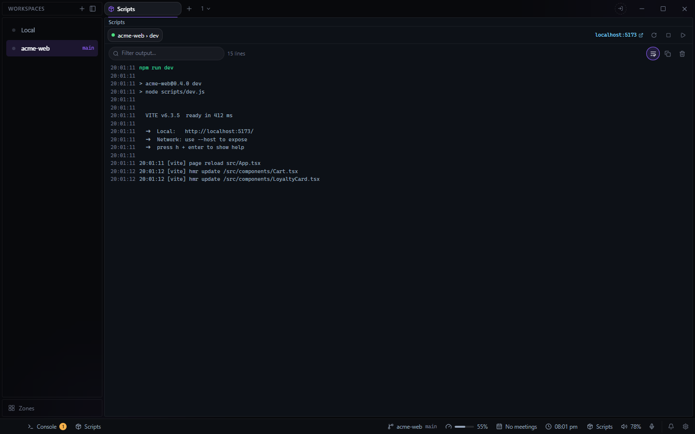

# Scripts for Deck

Run a `package.json` script, watch what it prints, and stop or restart it. It lives in the footer:
the ▶ there picks a script, and the running one shows with restart and stop. Its output is in a
drawer tab beside Console, which can also open as a pane from the **+** beside your tabs.

## What it does

- **Finds the scripts** in every `package.json` with scripts in the workspace, nested ones
  included (a monorepo's `apps/*` and `packages/*`, a frontend beside a backend), three folders
  deep. `node_modules` and build output are never searched.
- **Picks the package manager** from the lockfile (`pnpm-lock.yaml`, `yarn.lock`, `bun.lock` or
  `package-lock.json`), looking upward, so a package inside a pnpm workspace runs with pnpm.
- **Runs it with Deck holding the process.** The output has a filter, line wrap, copy and clear,
  and a dev server's local address becomes a link. Stop ends the whole process tree, so nothing
  is left holding the port. A script that fails or cannot start raises a Deck notification.
- **Notices scripts typed in a terminal.** `npm run dev` in a pane shows in the footer and the
  drawer, and stop and restart work on it with Ctrl+C. Its output stays in the terminal; the
  drawer offers a jump to it.
- **Keeps workspaces apart.** Only the active workspace's runs are shown, plus any run no
  workspace claims, so one an agent started elsewhere can still be stopped.
- **Command palette:** run any script in the workspace, or stop or restart a running one.

## For agents

The plugin adds `npm_list`, `npm_run`, `npm_stop`, `npm_restart` and `npm_log` to Deck's MCP
server: list the scripts and what is running, run one with Deck holding it, read its output, and
stop or restart it.

## Limits

- A script typed in a terminal is attributed to the workspace's folder, not the folder the
  terminal is in: Deck tells plugins a pane's workspace, not its current directory.
- Restarting a terminal run waits a fixed moment for the prompt before retyping the command.
  Under `cmd.exe`, a `.cmd` shim asks "Terminate batch job (Y/N)?" first, and the retyped
  command answers that instead. PowerShell, Deck's default shell, never asks.

Needs a project with a `package.json` and its package manager on PATH.
